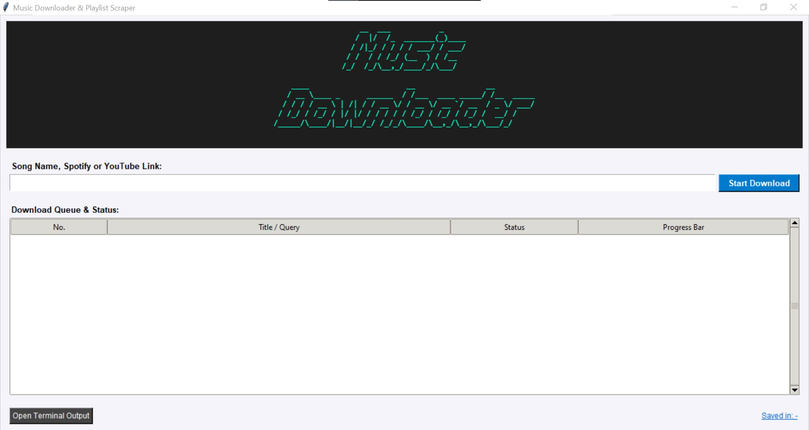
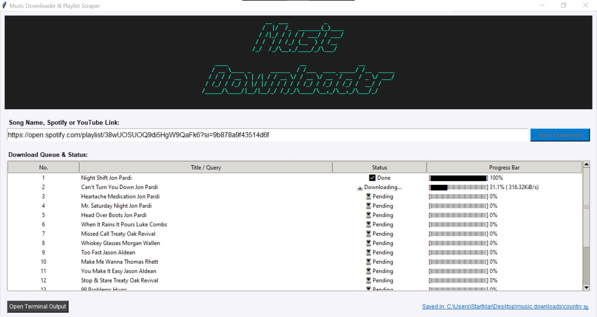

# Music Downloader & Playlist Scraper

A small, easy-to-use download tool for finding tracks and processing YouTube
or Spotify playlists. No account login is required to use the application:
enter a song name or paste a link, then follow the queue and per-item progress
in the desktop interface.

> **Use responsibly:** Only download or convert audio that you own or are
> explicitly authorized to use. You are responsible for complying with
> applicable copyright laws and the terms of service of YouTube, Spotify, and
> any other services you use. This project does not grant permission to copy or
> distribute music.

## Screenshots

### Main window



### Playlist and download progress



## Features

- Tkinter desktop interface with a search/link field and a download queue.
- Accepts a song name, a YouTube video or playlist link, or a Spotify playlist
  link.
- Displays each queue item with its title, status, and progress percentage.
- Marks completed and failed items separately.
- Writes audio as MP3 using FFmpeg, when the source and required tools allow it.
- Displays the destination folder and can open it in the system file explorer.
- Provides a separate terminal log window for status and error messages.

## Requirements

- Python 3.10 or newer.
- FFmpeg installed and available on `PATH`. The application uses it for MP3
  audio extraction.
- Python packages listed in [`requirements.txt`](requirements.txt).

## Setup

### Windows

Open PowerShell in the project directory and run:

```powershell
py -m venv .venv
.\.venv\Scripts\Activate.ps1
python -m pip install --upgrade pip
pip install -r requirements.txt
```

Install FFmpeg separately (https://ffmpeg.org/download.html), then make sure both `ffmpeg` and `ffprobe` are
available on `PATH`. To check:

```powershell
ffmpeg -version
ffprobe -version
```

If PowerShell prevents virtual environment activation, either allow activation
for your user according to your organization's policy or invoke the environment
interpreter directly:

```powershell
.\.venv\Scripts\python.exe -m pip install -r requirements.txt
.\.venv\Scripts\python.exe main.py
```

### macOS and Linux

Create and activate a virtual environment, install FFmpeg using your operating
system's package manager, and install the Python requirements:

```bash
python3 -m venv .venv
source .venv/bin/activate
python -m pip install --upgrade pip
pip install -r requirements.txt
```

## Using the application

1. Start the app with `python main.py`.
2. Enter a song name, a YouTube URL, or a Spotify playlist URL.
3. Select **Start Download** or press Enter.
4. Follow the queue: each row shows the title/query, current status, and
   progress. Failed items are marked as errors, and processing continues with
   the next item.
5. When processing finishes, the app displays the output folder. Click the
   folder path to open it.

The default output location is `~/Desktop/music downloads`. YouTube playlist
items are placed in a `YouTube Downloads` subfolder. Spotify playlist items
are placed in a subfolder named after the playlist.

For song-name searches and Spotify playlist entries, the app searches for a
matching YouTube result. A search result may not be the same recording as the
original track, so verify the result and your rights before using it.

## General workflow

The GUI passes the entered value to a background worker so the window can remain
responsive during network operations. The worker identifies the input type,
builds a download queue, and updates the queue status and progress as items are
processed. At the end, the application reports the output directory.

Playlist metadata and individual media downloads are separate steps. A playlist
can be read successfully even if a particular media item later fails; each
download has its own success or error status.

## Technical details

- **Entry point:** `main.py` creates the Tk root window, instantiates
  `MusicDownloaderApp`, and starts Tkinter's event loop.
- **Interface:** Tkinter and `ttk.Treeview` provide the input controls, queue,
  status columns, progress text, log window, and folder link.
- **Background work:** `threading.Thread` runs playlist processing and
  downloads outside the main GUI event loop. Progress and completion callbacks
  schedule their queue updates with `root.after`.
- **YouTube handling:** `yt-dlp` extracts video or playlist information. Search
  terms are sent as a single-result YouTube search.
- **Spotify playlist handling:** `spotify_scraper` retrieves playlist metadata
  and up to 500 tracks. The app combines each track name with its artist names
  to build a search query for the media lookup step.
- **Audio conversion:** `yt-dlp` is configured with the
  `FFmpegExtractAudio` postprocessor to produce MP3 output at 192 kbps. FFmpeg
  must be installed separately.
- **Progress and logs:** `yt-dlp` progress hooks update the row percentage and
  transfer speed. The log window displays high-level processing messages and
  errors.
- **Destination paths:** output is written beneath the user's Desktop in the
  `music downloads` directory. Playlist names are cleaned before being used as
  folder names.

## Project files

```text
.
├── main.py
├── requirements.txt
├── README.md
└── screenshots/
    ├── startsite.jpg
    └── download.jpg
```
